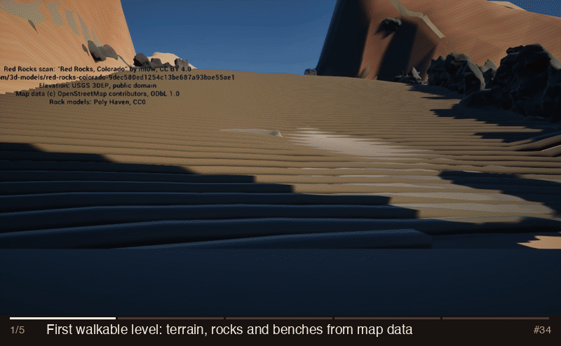
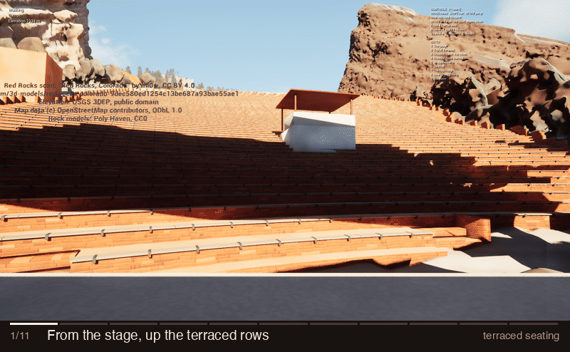
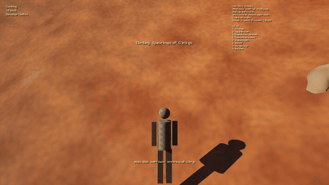
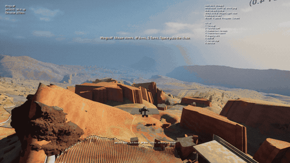
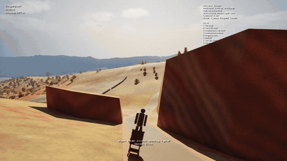
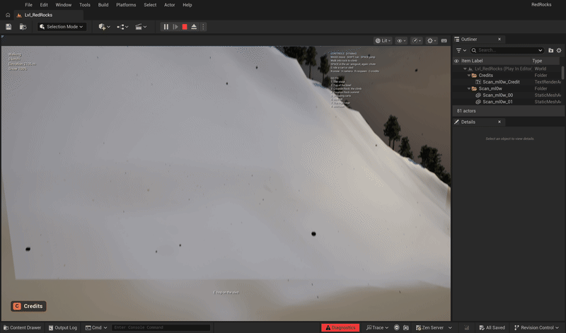
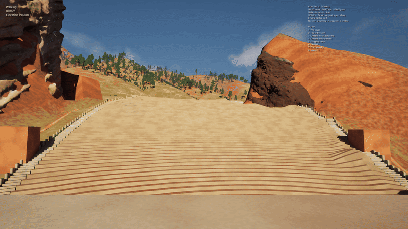
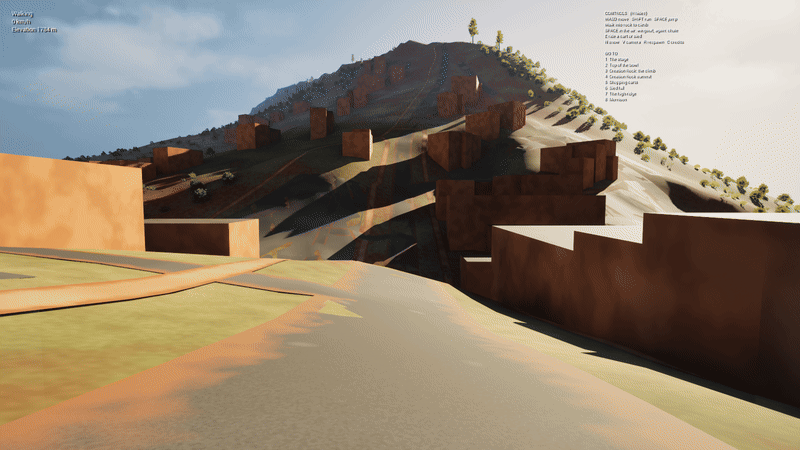
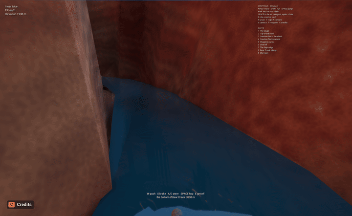

# red-dead-rocks

Builds a real-world **Red Rocks Amphitheatre** for Unreal Engine from public
geodata: a 1:1 terrain from the USGS DEM, the two flanking monoliths extruded
from their surveyed OSM footprints, and the OSM feature set for the park, all
georeferenced to a single origin.

This is the data half of the "GTA in your own city" idea. The Python package
writes engine-agnostic OBJ and heightmap files; the `unreal/` scripts import
them into a UE 5.8 project and build the level.

The local checkout lives at `~/dev/redrocks-ue`.

## Progress



*The same view from the stage, one frame per stage of the project. Each stage
adds a frame to `docs/media/progress/stages.json`; `tools/make_progress_gif.py`
rebuilds the GIF.*

## Status

Working: DEM fetch, heightmap and terrain-mesh export, OSM ingest,
georeferencing, seating-bowl generation, monolith meshes, tests.

**In Unreal:** the project is at `~/Documents/Unreal Projects/RedRocks`
(UE 5.8, Apple Silicon, a C++ module). Its level `/Game/RedRocks/Lvl_RedRocks`
is the editor startup map and the game default map, rebuilt from scratch by
`unreal/rebuild_level.py`: the 3.6 km terrain to Morrison, the ml0w drone scan
of the bowl and its rocks, terraced seating with aisle stairs and the sound
booth, the stage blockout, OSM roads, lots, buildings and rocks, about 100,000
trees, and the explorer's rides, snow, night and concert (see Explore it).

The Unreal project is versioned separately in
[red-dead-rocks-unreal](https://github.com/austin80808/red-dead-rocks-unreal)
(public, assets in Git LFS). After a rebuild that you want to keep, commit
there:

```bash
cd "$HOME/Documents/Unreal Projects/RedRocks"
git add -A && git commit -m "Rebuild: <what changed>" && git push
```

To roll the level back, `git checkout <commit> -- Content/` with the editor
closed.

The scan's placement is fitted by `tools/fit_scan.py` (scale within 8 % of
0.516 m/unit, then terrain heights plus stage and rock landmarks; issue #14 has
the residuals), on an absolute datum (see Scan edge blend).

**What is still a blockout:** the stage, its shell and the two stone towers
beside it, the walls and rocks extruded from OSM outside the scan, and the
parking lots. Next up is making those look like Red Rocks (see Next steps).

**Look (#18):** physically lit with Lumen GI and reflections, a 120 klx
early-morning sun low in the ENE (behind the player at spawn) through the SkyAtmosphere, a real-time sky
light, volumetric clouds, height fog and histogram auto exposure clamped to
EV100 11-14.2. The ground is procedural Fountain Formation sandstone: red soil
and olive grass on gentle slopes, banded red rock on steep ones, bands that fade
to their average colour with distance instead of shimmering. The rows are
terraces of stacked red flagstone with dusty sandstone treads and pale plank
benches on steel brackets (see Seating); the stage is concrete; roads,
lots and paths are asphalt and gravel with dusty edges. A generated terrain skirt
carries the hills out to the horizon (no more flat blue plane past the 3.6 km
terrain), and about 100,000 procedural junipers, ponderosa pines and scrub oak /
mountain mahogany cover the hillsides (see Vegetation).
`configure_level.py` writes the render settings this needs into the project's
`Config/DefaultEngine.ini` (restart the editor after the first rebuild).

## What it produces

```
out/
  redrocks_heightmap.png   2017x2017 16-bit heightmap, Unreal landscape format
  RedRocks_Terrain.obj     563x563 grid terrain mesh, 631,688 triangles, cm
  Creation_Rock.obj        north monolith, 91.4 m (300 ft), watertight
  Ship_Rock.obj            south monolith, 61.0 m (200 ft), watertight
  Stage_Rock.obj           east monolith, 18.3 m (60 ft), watertight
  Benches.obj              70 terraced rows + 1 front step, 21,940 triangles, terrain frame
  Bench_Planks.obj         two boards on every riser edge (43,696 triangles)
  Bench_Brackets.obj       1,807 steel brackets lined up about the stage (21,684 triangles)
  Handrail.obj             steel rail on the top walkway's parapet
  Stairs.obj               row-end aisle stairs and cheek walls, two steps per row (5,040 triangles)
  Booth.obj                the sound booth's posts and maroon roof, on its OSM footprint (way 229359709), squared to the stage
  scan_fade.png, .json     the scan's fade mask with the seating cut out (see Seating)
  Stage.obj                stage, Y-columns, trusses, FOH booth & bowl end stairs (462 parts, 5,536 triangles)
  Roads.obj, Paths.obj     OSM highways as draped ribbons (57,146 / 34,472 triangles)
  Parking.obj              53 OSM parking lots as terrain-following patches (52,338 triangles)
  Buildings.obj            314 OSM park & Morrison buildings with buried foundations & parapets (5,852 triangles)
  Walls.obj                100 OSM retaining walls, stone walls, fences & rails (36,432 triangles)
  Rocks.obj                242 surveyed OSM rock & cliff outcrops across the park (30,480 triangles)
  manifest.json            Z scale, bbox, origin, venue, monoliths, stage, park, explore (spots, cart route, sled hill), attribution
```

Clone with Git LFS installed: the scan, rock models and textures in `assets/`
are LFS files, and without it you get 133-byte pointer files instead.

```bash
git lfs install   # once per machine
git clone https://github.com/austin80808/red-dead-rocks.git
```

Run:

```bash
python3 -m venv .venv && .venv/bin/pip install -e .
.venv/bin/redrocks build --out out
.venv/bin/redrocks vegetation --out out   # trees and shrubs, reads out/'s terrain
```

`redrocks build` writes everything above. `--terrain-grid` sets the terrain
mesh resolution (default 377; `0` skips it).

### Seating

Red Rocks' rows are stepped terraces, not benches on a slope (Commons photos:
[from the side](https://commons.wikimedia.org/wiki/File:Red_Rock_Amphitheatre_Seatings.jpg),
[from the top row](https://commons.wikimedia.org/wiki/File:Red_Rocks_Amphitheater.JPG)):
a flat tread you walk along, a riser of stacked red flagstone, and a pale plank
bench on dark steel brackets along the riser's top edge. `redrocks.seating`
builds exactly that from the venue rows, in the terrain's frame:

| Piece | What it is |
|---|---|
| `Benches.obj` | one solid per row: its front face on the row's arc (the riser), a flat top at the row's tread level running back under the next row's riser, buried 0.3 m below the ground. Where row 1 stands more than 0.48 m over the ground in front of it, 0.4 m front steps lead up to it. |
| `Bench_Planks.obj` | two 14 cm boards on every riser's top edge, overhanging it 10 cm toward the stage, top 6 cm over the tread |
| `Bench_Brackets.obj` | a steel strap every 2.4 m (at the middle row) under the boards, at the **same bearings about the stage in every row**, so they line up into the radial lines the top-row photo shows converging on the stage |
| `Handrail.obj` (from `stage.py`) | posts and a top rail on the walkway parapet behind the last row |



**Rows end at their aisles: one staircase up each side.** The OSM theatre
outline runs into the rock walls and the two stone stage towers, so
`trim_row_ends` pulls each row's ends in until the aisle beside them (2.6 m
out, 2 m wide) is clear of buildings and of anything the scan shows standing
over 1 m tall (`seating_obstacles`, from `scan_top.npz` and `scan_ground.npz`).
Then, from row 4 up, each side's row ends are brought onto one line, the lower
envelope of where each row may end with a slope of 1 m a row, so the row-end
stairs make one continuous flight (consecutive steps at most 1.7 m apart, an
outer stone wall along it) instead of jogging row by row. Rows run unbroken
between their aisles. On the real data 68 rows give up 657 m
between them. Below row 4 the aisles start in the stage blockout's front corner;
that waits for the stage pass.

`tools/check_seating_clear.py` checks a build: no terrain, rock, wall,
building, path, road, lot or water vertex above a tread, no plant within 1 m of
the seating, no scan visible inside it, and no hidden scan more than a step over
a tread (unless the build wrote `out/seating_cut.json`, below). It exits 1 when
anything pokes through. The current build passes.

**The scan's collision under the rows.** Its chunks keep complex collision, and
under rows 13 and 63-69 the hidden scan holds things the drone caught (up to
3 m tall). `unreal/cut_scan_collision.py` (a `rebuild_level.py` step after
`import_scan.py`) gives each chunk that reaches the seating a collision-only copy
without the triangles over it (from `out/seating_cut.json`), set as the chunk's
`ComplexCollisionMesh`: 58,421 triangles in 10 of the 31 chunks. The scan still
looks the same and still collides everywhere you can see it, rocks included;
under the rows only the terraces are solid. Traced in the editor: every hidden
spot that stood a step over a tread now hits the tread first.

**Tread levels.** The scan's surface is too smooth to show the rows (its radial
profile has no row-spaced signal above 1 cm), so the levels come from the bowl's
profile: the median scan ground across each row's band, smoothed by a quadratic
in the row number, with rows whose band holds something else (rows
68, 69, 70: the top plateau) left out of the fit. The rises run
0.36 m at the bottom to 0.54 m at the top, 31.0 m in all
against the official 100 ft (30.5 m). You climb the bowl the way people do: up
the aisle stairs at the row ends, two steps a row. `unreal/playtest_explore.py`'s
`seating` scenario walks one aisle from row 8 to the top walkway on
`stage.aisles` from the manifest, walking only, no jumps or climbs: 28.7 m up in
115 s, within about 25 cm of the stair line. Below row 8 the aisles start in the
stage blockout's front corner, which is for the stage pass. The walker steers
by pure pursuit (it aims 70 cm ahead along the stair line), and it paces itself
to the editor's tick: the play-test steers once per Slate tick, about 3 Hz with
this level, and at full speed (5.2 m/s) it covered 1.7 m between steers and ran
off the aisle at every bend. The explorer's step height is 58 cm, so walking
straight up the rows works too; the planks and brackets have no collision.

**Clearance and the scan cut.** The scan chunks keep complex collision, and the
scan's surface in the bowl is a smooth ramp a few tenths over its fitted ground.
Treads sit 0.45 m over the profile, which keeps the scan under them, or within
15 cm of them, in 97 % of the bowl's 0.5 m cells (measured against the raw scan
points; 2 % is the tall scan below). `redrocks build` then
writes `out/scan_fade.png`: the scan's fade mask at 0.5 m with the seating cut
out, except where the scan stands more than 0.6 m over the tread
(`assets/scan/scan_top.npz`: the FOH booth, trees, the rocks at the row ends),
which stays visible so anything solid is something you can see.
`import_scan.py` uses it when it is there.

The row-end aisle stairs (`Stairs.obj`, in the same flagstone) climb from each
tread to the next across the row's band, two steps per row, and the stage's
walkway sits 2 cm under the top tread.

**The sound booth** stands where OSM has its roof (way 229359709,
`building=roof`, 5.3 x 5.1 m, around row 13 just off the centre line), not on
row 8 where the blockout had it. It keeps that footprint's centre and size but
is squared to the stage: OSM's outline runs about 21 degrees off the line to the
stage, so the booth is turned until its front looks straight at the stage front
centre (`facing_deg` in the manifest's `booth` entry, 31.7 degrees counter-clockwise
from east on the real data). Its deck sits 0.3 m over the highest tread under
it, so you step in from the row behind; a parapet faces the stage, and four
posts carry a flat maroon roof 2.6 m up (`Booth.obj`, `M_Roof`), like the one in
the top-row photo. The scan is cut out under the turned deck. The scan shows no
booth (it was flown without one), so nothing there is kept visible over it.

Current output for a 3.6 km box centred on the amphitheatre (it reaches
downtown Morrison; the box was 2.4 km until the explorable realm):

| | |
|---|---|
| DEM | 3025 × 3025, 1.19 m per pixel |
| Heightmap | 2017 × 2017, 16-bit, 1.78 m per pixel |
| Elevation range | 1742.1 m – 2403.5 m (661 m relief) |
| **Z scale** | **129.185** |
| Terrain mesh | 563 × 563 vertices (6.4 m cells), 631,688 triangles |
| OSM features | 21,353 nodes, 2,039 ways |

### Terrain mesh

The terrain goes into Unreal as a static mesh, not a Landscape. Landscape
heightmap import can't be driven from Python in vanilla UE, while an OBJ imports
through `AssetImportTask` like any other asset, including from a headless
commandlet. The cost is losing Landscape features (paint layers, grass,
Landscape LOD); the mesh can be swapped for a Landscape later.

Axes are X east, Y north, Z up, in centimetres, centred on the origin, with the
lowest point at Z = 0. Faces wind counter-clockwise seen from above, so normals
point up.

### Terrain frame and level frame

Everything the pipeline writes (OBJs, `manifest.json`, the scan rasters) is in
the **terrain frame**: right-handed, X east, Y north, Z up, like a map. Unreal
is left-handed (X forward, Y right, Z up; a yaw of +90 turns you right), so the
**level frame** puts north on -Y:

| | terrain frame | level frame |
|---|---|---|
| a point | (east, north, up) | (east, **-north**, up) |
| a heading (`yaw_deg` in the manifest) | degrees counter-clockwise from east | Unreal yaw = -heading |
| a compass bearing | degrees clockwise from north | Unreal yaw = bearing - 90 |

`unreal/level_frame.py` is the one place that converts; every Unreal script
goes through it, and `tests/test_level_frame.py` pins it (a point due north of
the stage is on your left when you face east; from the stage looking up the
bowl Creation Rock is on your right, Ship Rock on your left). Until
2026-11-04 the level put north on +Y and was a mirror image of Red Rocks:


*The play-test's view of the
[Commons seating photo](https://commons.wikimedia.org/wiki/File:Red_Rock_Amphitheatre_Seatings.jpg):
the real one has the rock on the left and the rows sweeping in from the right,
like the fixed level. More pairs in `docs/media/level-frame/`.*

### Roads, paths and parking

`park.py` turns the OSM `highway=*` and `amenity=parking` ways into three more
OBJs in the terrain's frame (cm, X east, Y north, Z up, Z=0 at the terrain
minimum): `Roads.obj`, `Paths.obj` and `Parking.obj`. A file is skipped when the
data has nothing for it, and each present one is recorded under `park` in
`manifest.json`.

Ribbons are swept along each way, sampled every 2 m and draped on the *same
triangles* as `RedRocks_Terrain.obj` (cell-diagonal aware, so no float over or
sink into the mesh), then lifted by 3 cm (parking), 5 cm (roads) or 7 cm
(paths) so layers don't z-fight. Widths by `highway=*`, in metres:

| Class | Width |
|---|---|
| motorway, trunk | 10 |
| primary | 8 |
| secondary | 7 |
| tertiary, unclassified, residential | 6 |
| living_street | 4.5 |
| service (parking aisle 3) | 4 |
| track | 3.5 |
| cycleway | 2.5 |
| footway, pedestrian, bridleway | 2 |
| path, steps | 1.5 |

`*_link` uses its parent class, and a numeric `width=` tag overrides the table.
Roads are motorway down to track; cycleway and below are paths.
`tunnel=*` ways and closed `area=yes` ways are skipped; other `highway` values
(construction, proposed ...) are ignored. Bridges are draped, with no deck.
Every face has UVs: on ribbons U is distance along the way divided by its width
(square texels) and V runs 0 to 1 across; on parking, planar metres / 10.

### Monoliths

Both flanking rocks are extruded from their **surveyed OSM footprints**, so the
plan-view silhouette is real rather than invented. Heights come from the
official figures, not the DEM — the DEM reads 20–40 ft high because it samples
the ridge behind each rock.

| | footprint | height | top elevation |
|---|---|---|---|
| Creation Rock (north) | 163.6 × 94.8 m, 8,132 m² | 91.4 m (300 ft) | 2023.8 m |
| Ship Rock (south) | 236.1 × 177.2 m, 18,647 m² | 61.0 m (200 ft) | 1993.4 m |
| Stage Rock (east) | 45.5 × 38.3 m, 1,028 m² | 18.3 m (60 ft) | 1950.7 m |

In addition, `park.py` extrudes the other 239 surveyed OSM `natural=bare_rock|stone|cliff` polygons across the park (Tethys Rock, Picnic Rock, Frog Rock, Lizard Head Rock, Seven Ladders Rock, Park Cave Rock and Entry Rock) into `Rocks.obj` in the terrain frame, with buried foundations and battered 3-tier sandstone cliffs, alongside `Buildings.obj` (314 park and Morrison buildings with buried foundations and Pueblo-Revival parapet rims) and `Walls.obj` (63 retaining walls, stone walls, wood fences and guard rails).

Meshes are watertight, outward-facing, and their volume matches
footprint × height to six digits. Units are centimetres, matching Unreal. Side
walls carry UVs with perimeter distance along U and height along V, so strata
banding in a material runs horizontally.

The 30° westward strata dip is **not** applied as a geometric shear. The
monoliths are vertical columns; the dip is a property of the bedding and belongs
in the material as diagonal banding. Shearing the mesh would fake a lean that
does not exist.

### Stage blockout

`Stage.obj` is a blockout, not a model: boxes and wedges (vertical prisms with a
convex plan) for the stage deck, roof slab, four columns, the shell (back wall and
two splayed wings), the retaining wall behind the stage with a triangular return
at each end, and the walkway along the top of the bowl. It is one watertight
`Stage` object in the terrain's frame (cm, X east, Y north, Z up, terrain
minimum at Z = 0), counter-clockwise outward, with a UV on every face, so it
needs no transform in Unreal. `manifest.json` records the triangle range of each
part and every dimension with its source.

It is positioned from the data, not by hand. The stage axis runs from row 1's
centre to the last row's centre. The deck top is the stage drop below row 1's
tread (the ml0w scan's ground under row 1, where its bench stands), raised to
clear 75 % of the scan's ground under the front half of the deck (the scan's own
stage wings stand a few metres proud along its sides). Its front edge sits 3 m
downhill of row 1, and it extends away from the audience. The walkway runs along
the last row's chord, on the scan's ground behind the top row. On the real build
the deck top is about 0.3 m over the scanned deck.

**Sizes come from the ml0w scan where it could be measured.** `kind` in
`redrocks.stage.DIMENSIONS` is `published`, `derived`, `measured` (read off the
scan by `tools/measure_stage_scan.py`) or `estimate` (neither). The scan has no
units, so the script finds its own scale first from published figures: about
**0.516 m per scan unit** (bench rise 0.496, roof underside against the 12.24 m
SkyDeck grid 0.513, Creation/Ship Rock top difference 0.541, so roughly +-4%).
The fit used to place the scan in Unreal (`FIT_SCALE` in `unreal/import_scan.py`,
0.312 m per unit) is about 40% too small and puts the stage about 375 m from the
bowl; see issue #14. Measured values are right only to the confidence in their
source text: the roof is partly reconstructed and the scan cannot tell the
retaining wall from the rock it stands against.

| Dimension | Value | Kind | Confidence / source |
|---|---|---|---|
| Stage width | 26.3 m (was 24.4 estimate) | measured | roof plan width, medium-low (+-1.5 m); flat deck seen is at least 20.9 m |
| Stage depth | 27.9 m (was 21.3 estimate) | measured | deck front lip to the wall behind, medium (+-1.5 m) |
| Roof depth | 21.9 m, starting at the deck front | measured | medium (+-1.5 m); deck runs about 6 m further back |
| Roof slab sits at | 12.24 m (40'2") above deck | published | [IA Stage](https://www.iastage.com/red-rocks-amphitheater/); the scan's roof underside is 12.33 m |
| Roof thickness | 2.1 m (was 1.5 estimate) | measured | scan roof top 14.46 m minus the 12.33 m underside, medium-low (+-0.7 m) |
| Truss 1 / truss 3 behind downstage edge | 3.66 m / 18.90 m | published / derived | 12 ft, then 25 ft apart, [IA Stage](https://www.iastage.com/red-rocks-amphitheater/) |
| Columns | 4 | published | reduced from twelve, [Structure magazine](https://www.structuremag.org/article/new-stage-roof-rocks-iconic-venue/) |
| Deck top | row 1 elevation minus 0.2 m (was 1.2 m estimate) | derived + measured | deck level with the row-1 tread within 0.4 m, low confidence |
| Retaining wall gap / height | 2.1 m / 12.9 m (were 2.0 / 6.0 estimates) | measured | low (+-1 m / +-2 m): the height is the whole rear face, rock included |
| Front setback, columns size, shell, walkway width | see `stage.py` | estimate | not resolvable in the scan |

Re-run the measurement (needs `usd-core` in a venv, not a project dependency):
`.venv/bin/python tools/measure_stage_scan.py --cache $SCRATCH/scan.npz --out $SCRATCH/diag`.
It also writes a top-down height map and an axis cross-section with the
blockout outlines drawn over the scan.

## Scan edge blend

The ml0w scan and the 3DEP terrain differ by a median of about 4 m, and by
15 m or more around the rock fins, so the terrain used to bury a third of the
scan and the scan's ragged edge floated as shelves. Two halves fix it (#17):

* **Terrain** (`redrocks.scan_blend`, run by `redrocks build`): inside the
  scan's footprint the terrain mesh's vertices take the scan's own floor, 0.4 m
  lower, then drop wherever a triangle would still rise into the scan, so the
  scan always draws on top and the walkable ground follows it. Over 60 m outside
  the footprint a smooth (harmonic) fill takes the ground back to the DEM. Roads,
  paths and parking drape on the blended ground; the monoliths and the heightmap
  stay on the DEM. Nothing is kept out any more, the bowl included: the terrain
  is under the scan everywhere, so none of it shows between the rows or in a
  strip north of the bowl (it used to keep the DEM under the benches and stage,
  which stood 1 to 2 m over the scan's bowl).
* **Benches, stage and spawn** stand on the scan's ground (`ScanGround`): a
  plane fitted to the scan points around each 1 m cell, with roofs and trees left
  out (`ground_surface`). The seating's tread levels are fitted to it (see
  Seating); the terraces' bottoms also reach down to the terrain under the scan,
  so nothing floats where the scan thins out. The scan's floor raster (lowest
  point per 2 m cell) sits ~0.37 m under the bowl's slope, which is why the
  seating uses the fit. The seating OBJs carry flat face normals (`vn`), so
  `M_Benches` can tell treads from risers by their normal.
* **Scan datum** (`FIT_DATUM_M` in `import_scan.py`): `FIT_OFFSET_CM`'s Z is
  measured from 1753.98 m, the level's Z = 0 when the scan was fitted (the
  2.4 km world). The 3.6 km world moved Z = 0 11.88 m lower and the scan did not
  follow, so from #49 until this fix it sat 11.88 m under the terrain that was
  blended to it: the bowl was buried and the terrain's smooth copy of the rocks
  stood over the scanned ones. `import_scan.py` now adds `FIT_DATUM_M` minus the
  manifest's base, and `tools/scan_heights.py` rasterises on the datum.
* **Scan material** (`unreal/import_scan.py`): `M_Scan_ml0w` is masked. A plan-view
  fade mask (0 at the footprint edge, 1 from 30 m in) broken up by world noise
  thins the scan into patches toward its edge, DitherTemporalAA softens them,
  and the last of it is tinted to the ground colour read from
  `MI_Sandstone_Ground`. Near-black texels in the scan's albedo are lifted toward
  shaded sandstone.

`tools/scan_heights.py` writes the inputs for both, `assets/scan/scan_heights.npz`
(scan floor, 2 m cells), `assets/scan/scan_ground.npz` (scan ground, 1 m cells),
`assets/scan/scan_top.npz` (the scan's highest point per 1 m cell) and
`assets/scan/scan_fade.png` + `.json` (the mask and where it sits). Pass
`--scan` the USD, or a points cache (`.npz`, key `P`) to skip `usd-core`. Re-run it whenever the `FIT_*` constants in `import_scan.py`
change, then `redrocks build` and `rebuild_level.py`.

How it changed is in the Progress GIF at the top (the scan blend's own
before/after shots are in `docs/media/scan-blend/` and
`docs/media/benches-on-scan/`).

## Vegetation

The hillsides carry about 237,000 procedural plants, modelled on summer photos
of Red Rocks Park: Rocky Mountain and one-seed juniper, ponderosa pine, Gambel
(scrub) oak and mountain mahogany. Nothing is downloaded: `redrocks.vegetation`
grows every model from a seed, `redrocks.foliage_atlas` paints the leaf textures
with Pillow at real size, and `redrocks vegetation --out out` writes them to
`out/vegetation/` with `vegetation.json`, the list of instances.

| Species | Models | Instances | Looks like |
|---|---|---|---|
| Rocky Mountain juniper | `JuniperRM_0..2`, 5.0 m | 3-6 m | a dense, almost solid oval-to-conical mass, dark grey-green, shaggy edge |
| One-seed juniper | `JuniperOS_0..2`, 3.6 m | 2-4 m | several stems, a broad rounded crown down to the ground |
| Ponderosa pine | `Ponderosa_0..4`, 18 m | 12-25 m | a straight trunk clear for about a third of its height; crooked limbs that dip and turn up; needles only in foxtail tufts at the branch and twig tips, sky between the tiers. 0 young and conical, 1-3 mature, 4 old and flat-topped |
| Gambel oak | `Oak_0..2`, 2.6 m | 1.5-4 m | many stems, leafy almost to the ground |
| Gambel oak patch | `OakPatch_0..2`, 2.6 m | 3-6 m across | a clonal thicket: many stems under one continuous canopy |
| Mountain mahogany | `Mahogany_0..2`, 2.1 m | 1-3 m | twiggy and open, small grey-green leaves, feathery seed plumes |

**Leaves are drawn at real size.** Each atlas tile is one leaf card of a known
width (juniper 0.32 m, pine 0.48 m, oak 0.38 m, mahogany 0.28 m) and the
painter works in metres: oak leaves 5-12 cm with rounded lobes, mahogany
leaves 2-3.5 cm, ponderosa needles 10-18 cm, juniper sprays of 1-2 mm
branchlets. Opaque crown cores carry each plant's mass and the masked cards
clothe them, so the costly masked overdraw stays on the outer shell.

Each model is three OBJs (cm, with UVs and normals on every face):
**Trunk** (closed tapered tubes, watertight; the only part with collision, and
only on trees), **Crown** (the opaque cores) and **Leaves** (cards into the 2x2
atlas, their normals bent out from the crown so it shades as a volume).
`unreal/setup_vegetation.py` imports them with Nanite, builds `M_Veg_Bark`
(world-space plates and fissures that blend to one dark grey-brown from 6 to
15 m away, as ponderosa trunks look in photos), `M_Veg_Leaves` (masked,
two-sided, Two Sided Foliage) and `M_Veg_Crown`, and fills one instanced-mesh
component per model part on a `Vegetation` actor. Run `setup_snow.py` after it
(`rebuild_level.py` does), since it rebuilds the materials the snow is wired into.

**Where they grow** (`redrocks.vegetation.place`, seeded, so every rebuild is
the same):

- **Scrub thickets** (`in_thicket`): oak patches, oak and mahogany on a
  jittered 4.1 m grid cover the lower slopes and draws with about 60 %
  canopy; the grassy openings between keep a few lone bushes.
- **Junipers** stand singly or in twos and threes, more on rocky
  south-facing ground. **Ponderosa** grows in groves of 3-8 on the upper
  and north-facing slopes.
- Nothing grows on cliffs (steeper than 33 degrees for shrubs, 37 for pines,
  40 for junipers), in the scanned bowl, or in buildings and walls. Trees keep
  8 m off roads, paths, parking, buildings, walls, benches, the stage and the
  sled run, and 2.5 m (pines) or 1 m (junipers) from each other; scrub grows
  right up to the edge of roads, paths and buildings (2 m cells from their
  triangles) without its canopy ever reaching over them.
- Every plant is sunk so that no stem root stands above the ground under it,
  however it is turned: oak patches on a slope root deeper downhill.
- Shrub crowns are never culled, so the hillsides read as covered from the
  air; shrub leaves and stems fade out from 320 to 400 m.

**Side by side with Red Rocks Park** (before | after | photo; colour error
ΔE of the sampled foliage and bark in [`delta_e.json`](docs/media/vegetation-real/delta_e.json)):


Photos from Wikimedia Commons:
[Red Rocks Park in Denver](https://commons.wikimedia.org/wiki/File:Red_Rocks_Park_in_Denver.jpg) (Bigmacthealmanac, CC BY-SA 4.0),
[Conifer (Red Rocks Park, west of Denver, Colorado, USA)](https://commons.wikimedia.org/wiki/File:Conifer_(Red_Rocks_Park,_west_of_Denver,_Colorado,_USA).jpg) (James St. John, CC BY 2.0),
[Trail views in Red Rocks Park, Morrison, Colorado](https://commons.wikimedia.org/wiki/File:Trail_views_in_Red_Rocks_Park,_Morrison,_Colorado.jpg) (Lovemedead, CC BY-SA 4.0),
[RedRocks.jpg](https://commons.wikimedia.org/wiki/File:RedRocks.jpg) (Hogs555, CC BY-SA 3.0).
Because they contain those photos, the four composites in
`docs/media/vegetation-real/` are CC BY-SA. The photos themselves are not
committed: `tools/make_reference_compare.py` fetches them into `out/refs/`.

Regenerate the comparisons: shoot `before_`/`after_` with
`unreal/shoot_vegetation.py` (needs the editor GUI; the four photo-matched
cameras are in `docs/media/vegetation-real/views.json`), then
`python tools/make_reference_compare.py --shots out/shots --out docs/media/vegetation-real --cache out/refs`.


## Explore it

Red Rocks is a place to roam, not just a bowl to walk up. The level's game mode
is `RRGameMode` from the project's C++ module (`Source/RedRocks` in the Unreal
project), and everything below is placed from the map by `redrocks build`
(`src/redrocks/explore.py`, the manifest's `explore` block) and
`unreal/setup_explore.py`.

| Do | How |
|---|---|
| **Climb the rocks** | Walk into any face too steep to stand on (Creation Rock, Ship Rock, the scan's fins, a cliff). WASD climbs, Shift climbs faster, keep pushing up at the top to pull over the edge, Space leaps off, Q lets go. |
| **Wingsuit off the rocks** | In the air more than 5 m up, press Space. Mouse steers, A/D banks, W dives for speed, S flares. Space again opens the parachute (A/D turn, W/S speed, Q cuts away). Hit a rock too fast and you splat; R puts you back. |
| **Shopping cart to Morrison** | Three carts wait at the top of Red Rocks Park Road (2000 m). E climbs in, W pushes off, S brakes, A/D steer, Space hops. The road drops 217 m over 3.4 km to Bear Creek Avenue in downtown Morrison; the HUD counts down the metres. Carts roll on the road and bog down off it; hit a wall over ~54 km/h and you're thrown out. |
| **Sled when it snows** | Press N and it snows: flakes fall, the ground, benches, roads and trees whiten (every material reads `MPC_Weather`'s `Snow`), the sun dims and the fog closes in. Sleds on the sled hill (a 318 m run, 89 m drop, cleared of trees) only run well on snow. Carts drift on it. |
| **Tube Bear Creek** | Inner tubes wait where Bear Creek enters the world in its canyon. E grabs one; the current carries you 4.5 km and 175 m down through Morrison, lazy on the flats and quick through the riffles. W paddles, A/D steer, and the tube turns slowly as it goes. The creek is `Water.obj`, a ribbon along OSM's Bear Creek whose level never runs uphill. |
| **Night and a concert** | Press T: the sun sets, a moon rises, exposure opens up, and the stage rig plays: eight moving heads sweeping the rows and six beams fanning into the haze, changing colour every bar at 124 BPM. T again for morning. |
| **Go places** | Number keys teleport (1 lands on the stage deck, not its roof; 2 on the top walkway): 1 stage, 2 top of the bowl, 3 the climb, 4 Creation Rock summit, 5 shopping carts, 6 sled hill, 7 the high ridge (2403 m, the longest wingsuit flight), 8 Bear Creek tubing, 9 Morrison. H shows the controls, V swaps to a third-person camera, R respawns. |

| Climb Creation Rock | Wingsuit off the summit |
|---|---|
|  |  |
| **Shopping cart down Red Rocks Park Road** | **Sled when it snows** |
|  |  |
| **The amphitheatre, then N for snow** | **Morrison** |
|  |  |
| **Bear Creek tubing** | **T for night: the stage concert** |
|  |  |

*All captured by `unreal/playtest_explore.py` (`FILM=1` for the motion frames). The
clean run: climbed 49.9 m and pulled over the top, flew 353 m at up to 101 km/h and
landed under the canopy, rode the cart 3,270 m into Morrison at up to 74 km/h, and
sledded 259 m at up to 80 km/h.*

The world is now 3.6 km across (it was 2.4 km), so downtown Morrison is in it:
314 buildings, 315 roads, and about 100,000 plants.

**Where things go is computed, not placed by hand.** The cart lot is the
highest drivable road node within 700 m of the bowl; the route is the shortest
road path from there to Bear Creek Avenue. The sled hill is the longest fall
line near the bowl (120 to 320 m) that keeps between 10 % and 50 % grade, stays
off roads, paths and buildings, and is scored toward a 28 % grade;
`redrocks vegetation` keeps trees off it. Spots snap onto whatever is really
there when play starts, so the summit lands on the scanned rock top and the
climb spot walks to the scanned face.

To check it all without a keyboard:

```bash
"/Users/Shared/Epic Games/UE_5.8/Engine/Binaries/Mac/UnrealEditor.app/Contents/MacOS/UnrealEditor" \
  "$HOME/Documents/Unreal Projects/RedRocks/RedRocks.uproject" -nosplash \
  -ExecCmds="py /Users/austin/dev/redrocks-ue/unreal/playtest_explore.py"
```

It climbs Creation Rock, wingsuits off its summit and lands under a parachute,
rides a cart from the lot to Morrison steering along the road like a player,
makes it snow and sleds the hill, then looks around Morrison. Results go to
`/tmp/redrocks_playtest_explore.log`, screenshots to
`Saved/Screenshots/MacEditor/redrocks_explore_*.png`. `SCENARIOS=cart,sled`
runs a subset.

**The C++ module.** The Unreal project is no longer Blueprint-only. Build it
once after pulling (the editor also offers to when it opens):

```bash
"/Users/Shared/Epic Games/UE_5.8/Engine/Build/BatchFiles/Mac/Build.sh" RedRocksEditor Mac Development \
  -Project="$HOME/Documents/Unreal Projects/RedRocks/RedRocks.uproject" -WaitMutex
```

| Class | Does |
|---|---|
| `ARRExplorer` | the player: walk, sprint, climb, mantle, wingsuit, parachute, ride; test hooks `ScriptMove`, `ScriptPress`, `ScriptLook`, `RRGo` |
| `ARRRide` | shopping cart, sled or inner tube: rolls or slides on whatever is under it, rolling resistance by surface and snow, sideways grip, crests, air, wipeouts |
| `ARRWeather` | snow: falling flakes around the camera, the `Snow` cover parameter, sun, sky and fog; night: sun below the horizon, moon, exposure, volumetric haze |
| `ARRConcert` | the stage light rig: moving heads and sky beams on the beat, on only at night |
| `ARRSpot` | a teleport spot; drops onto the ground (or a summit) and can walk to a rock face |
| `ARRHUD`, `ARRGameMode` | status, hints, toasts, controls; the game mode that ties it together |

## Play it


*Captured by `unreal/playtest.py` in the real project: the player spawns on the stage, walks 53 m and climbs 13 m up the bowl, then looks east, north, west and south, under the early-morning sun.*


*From above: the ml0w scan's Ship Rock and Creation Rock blended into the generated terrain, with vegetation, roads and parking. Regenerate both with `tools/make_play_gifs.sh` after a play-test.*

Open the project, make sure `Lvl_RedRocks` is the open level, and press **Play** (green ▶).
You spawn on the stage deck facing up the bowl, with the credits beside you.
WASD to walk, mouse to look, Space to jump. Climb the aisle stairs at either end of the rows (or straight up the rows: every riser is under your step height).
Press **C** to open or close the credits screen (a "C Credits" hint sits in the bottom-left corner).


The credits overlay is generated by `unreal/setup_credits.py`; its text comes from
`assets/*/ATTRIBUTION.md` and `out/manifest.json`'s `attribution` list, so it can't drift
from the sources. To check it without the keyboard:

```bash
"/Users/Shared/Epic Games/UE_5.8/Engine/Binaries/Mac/UnrealEditor.app/Contents/MacOS/UnrealEditor" \
  "$HOME/Documents/Unreal Projects/RedRocks/RedRocks.uproject" -nosplash \
  -ExecCmds="py /Users/austin/dev/redrocks-ue/unreal/playtest_credits.py"
```

It presses C through Enhanced Input (`Input.+key C`), writes `/tmp/redrocks_playtest_credits.log`
and saves `redrocks_credits_{hint,open,closed}*.png` under `Saved/Screenshots/MacEditor/`.

To check it without touching the keyboard:

```bash
"/Users/Shared/Epic Games/UE_5.8/Engine/Binaries/Mac/UnrealEditor.app/Contents/MacOS/UnrealEditor" \
  "$HOME/Documents/Unreal Projects/RedRocks/RedRocks.uproject" \
  -ExecCmds="py /Users/austin/dev/redrocks-ue/unreal/playtest.py"
```

It writes `/tmp/redrocks_playtest.log` and two screenshots under `Saved/Screenshots/`.

## Importing into Unreal

The scripts in `unreal/` run headless against the project:

```bash
UE="/Users/Shared/Epic Games/UE_5.8/Engine/Binaries/Mac/UnrealEditor-Cmd"
PROJ="$HOME/Documents/Unreal Projects/RedRocks/RedRocks.uproject"
"$UE" "$PROJ" -run=pythonscript -script=unreal/import_redrocks.py -unattended -nosplash -stdout
```

**To rebuild the whole level, run one script.** `rebuild_level.py` runs the
thirteen steps below in order (`import_redrocks.py` through `setup_explore.py`), clears
each step's old log first, stops at the first `ERROR`/`ABORT`/`FAIL` line in its
`/tmp/redrocks_*.log` (or a missing log), and prints a summary of step, status,
duration and log path (also saved to `/tmp/redrocks_rebuild.log`):

```bash
"$UE" "$PROJ" -run=pythonscript -script="$PWD/unreal/rebuild_level.py" -unattended -nosplash -stdout
```

or, in an open editor, `py "/Users/austin/dev/redrocks-ue/unreal/rebuild_level.py"`.
It **wipes every actor in the level** (step 1). The scripts can still run one at
a time, in this order; each writes a log to `/tmp/redrocks_*.log`:

| Script | Does |
|---|---|
| `rebuild_level.py` | **entry point:** runs the thirteen scripts below in order, stops at the first failure |
| `import_redrocks.py` | imports the terrain, rocks and seating terraces (`Benches.obj`) to `/Game/RedRocks` and places them in `Lvl_RedRocks`. **Clears every actor in the level first.** |
| `setup_lighting.py` | low morning sun (120 klx, ENE, 24° up, behind the spawn), sky atmosphere, real-time sky light, height fog, volumetric clouds, PlayerStart. Replaces the rig on every run |
| `configure_level.py` | writes Lumen / distance fields / VSM / eye adaptation / TSR into `Config/DefaultEngine.ini` `[SystemSettings]`; post-process volume with Lumen, auto exposure (EV100 11-14.2) and a light grade; framing camera |
| `fix_camera.py` | lifts the camera above the 645 m ridge, removes test actors |
| `setup_materials.py` | procedural materials: `M_Sandstone` (30° strata that fade with distance, soil, grass, slope rock) with rock and ground instances; `M_Benches` (dusty sandstone treads, stacked red flagstone risers), `M_BenchWood` (plank boards), `M_Steel` (brackets, handrail); `M_Concrete`, `M_Asphalt`, `M_Lot`, `M_Gravel` |
| `setup_environment.py` | terrain skirt from the DEM edge out to 120 km so the world has a horizon |
| `setup_vegetation.py` | imports `out/vegetation/` (from `redrocks vegetation`): leaf atlases, bark/leaf/crown materials, 16 Nanite tree and shrub models, and every instance into one `Vegetation` actor; tree trunks block, canopies and shrubs don't |
| `import_scan.py` | imports the ml0w scan with Nanite and credits it, at `FIT_DATUM_M` above the level's datum; its material fades the scan out at its edge and over the seating (`out/scan_fade.png`, see Seating); run after `import_redrocks.py` |
| `cut_scan_collision.py` | cuts the seating out of the scan's collision: collision-only copies of the chunks that reach it, without the triangles over it, as their `ComplexCollisionMesh` (from `out/seating_cut.json`). Run after `import_scan.py` |
| `setup_gameplay.py` | imports Stage, Roads, Paths, Parking; complex collision on every walkable mesh and on the scan (the hidden extruded rocks get none); PlayerStart on the stage deck facing up the bowl; FirstPerson game mode; in-world credits. Runs last |
| `setup_snow.py` | `MPC_Weather` (one scalar, `Snow`) and a snow layer in every `/Game/RedRocks` material: up-facing surfaces lerp to packed snow as `Snow` rises, in patches. Re-running skips materials that already have it |
| `setup_explore.py` | the explorable realm: teleport spots, three shopping carts bound for Morrison, three sleds, the weather actor, `road`/`parking` tags, and the `RRGameMode` game mode. Needs the C++ module built. Runs last |
| `setup_credits.py` | the press-**C** credits screen: input action `IA_Credits` (C, in `IMC_Default`), Widget Blueprint `WBP_Credits`, Actor Blueprint `BP_CreditsMenu` placed in the level. Text from `assets/*/ATTRIBUTION.md` and the manifest. Runs after `setup_gameplay.py` |
| `verify_walkable.py` | headless checks: game mode, one PlayerStart, triangle counts kept, credits present; renders the spawn and bowl views |
| `playtest.py` | **the real test:** launches Play In Editor, lets the player land, walks and jumps up the bowl for 12 s, screenshots, quits. Needs the editor GUI (`-ExecCmds="py …"`) |
| `shoot_vegetation.py` | Play In Editor, flies to the bowl-top, hillside (a juniper and a pine) and aerial views, screenshots each and logs FPS. Needs the editor GUI |
| `playtest_explore.py` | Play In Editor through every activity: up the seating's aisle stairs (with the three photo views), climb, wingsuit and parachute, cart to Morrison, snow and sled, tubing, night, Morrison. `SCENARIOS=seating,bowl` runs a subset, `FILM=1` films. Needs the editor GUI |
| `playtest_credits.py` | Play In Editor, checks the hint, presses C (open), C (close), screenshots each (`Shot showui`), quits. Needs the editor GUI |
| `render_preview.py` | renders the level to `Saved/redrocks_preview.png` |
| `diagnose.py` | lists actors, mesh triangle counts and the startup map |

Close the editor before running them, or the commandlet and the editor will
both hold `Lvl_RedRocks`. Inside a running editor, run one from the console
instead: `py "/Users/austin/dev/redrocks-ue/unreal/diagnose.py"`.

The `probe_*.py` scripts are the experiments that found the import problems
below; they are kept for reference.

### Driving the editor from Claude (MCP)

The project enables Epic's `ModelContextProtocol` and `AllToolsets` plugins
(red-dead-rocks-unreal#12), so Claude Code can work on the open level through
Epic's [Unreal Engine skills plugin](https://github.com/EpicGames/unreal-engine-skills-for-claude-code-plugin):
trace the world, find actors by a physics overlap, inspect materials, meshes and
collision, run automation tests. `.mcp.json` (here and next to the `.uproject`)
points at the editor's server, `http://127.0.0.1:8000/mcp` (localhost only). It
starts with the editor when your per-user settings say so:

```ini
# <project>/Saved/Config/MacEditor/EditorPerProjectUserSettings.ini
[/Script/ModelContextProtocolEngine.ModelContextProtocolSettings]
bAutoStartServer=True
```

or run `ModelContextProtocol.StartServer` in the editor console. The scripts in
`unreal/` stay the way the level is built; MCP is for looking at it live.

### Landscape instead of a mesh

To use the heightmap as a Landscape:

1. New level, enable the **Landscape** plugin.
2. Landscape mode → **Import from File** → `out/redrocks_heightmap.png`.
3. Set **Scale X/Y** to `118.99` (cm per pixel, from the manifest) and
   **Z Scale** to `126.2013`.
4. The terrain is now 1:1 with reality. Place the player at the origin from
   `manifest.json` and the amphitheatre is where it should be.

The Z scale formula is `relief / 512 * 100`, because Unreal's landscape maps the
full 0–65535 heightmap range onto 100 units per 512 units of scale.

### Unreal gotchas

Each of these cost real time:

- **`unreal.Rotator` positional order is (roll, pitch, yaw).** Always pass
  keywords: `unreal.Rotator(pitch=-38, yaw=145, roll=0)`. Positional
  `(-38, 145, 0)` gives pitch 145°, which puts the sun below the horizon:
  the level renders as night, with black terrain and black sky.
- **OBJs need a UV channel.** Without `vt` lines, the OBJ importer fails an
  ensure and keeps only a fraction of the triangles (a 282,752-triangle terrain
  came back with 3,716). Every exported OBJ now carries UVs.
- **Unreal is left-handed, so north goes on -Y.** Interchange's OBJ importer
  negates Y (a vertex at north = +12071 cm lands at y = -12071), which is
  exactly the terrain -> level map, so OBJ actors keep scale (1, 1, 1). Every
  position from the manifest must be negated the same way
  (`level_frame.to_level_cm`), or the meshes and the actors placed from the
  manifest disagree and the player spawns on the benches instead of the stage.
  The level used to undo the importer with a Y scale of -1 on every OBJ actor
  and place everything at +north: self-consistent, but a mirror image of the
  real place (facing east, north was on your right).
- **`EditorAssetLibrary` does nothing while Play is running.** `load_asset` and
  `load_blueprint_class` return None during Play In Editor; use `unreal.load_asset`
  / `unreal.load_object` in play-test scripts.
- **UE 5.8 Python can author Blueprints and widgets headless.**
  `unreal.BlueprintGraphEditor` adds nodes and wires pins,
  `EditorUtilityLibrary.add_source_widget` builds a widget tree. Gotchas:
  `create_node_from_name` wants the menu path with spaces removed
  (`"UserInterface|CreateWidget"`, `"Input|EnhancedActionEvents|IA_Credits"`);
  a math node like Subtract is a wildcard until a pin is wired, so wire one
  input before setting the other's literal; most widgets (TextBlock, Border,
  panels) aren't Blueprint variables, but a WidgetSwitcher is.
- **`HighResShot` leaves out the UI.** To capture a UMG overlay use
  `Shot showui filename=<name>` (it appends a `00000` suffix).
- **`-ExecutePythonScript` quits the editor when the script returns.** For
  anything that has to run over several frames (Play In Editor), launch with
  `-ExecCmds="py <script>"` instead.
- **A PlayerStart buried in geometry is ignored.** Unreal drops a start whose
  capsule overlaps blocking geometry and spawns the pawn at the origin, under
  the terrain. The spawn height comes from manifest.json's `spawn` block.
- **`spawn_actor_from_object` does nothing in a headless commandlet.** Spawn a
  `StaticMeshActor` with `spawn_actor_from_class` and set its mesh instead.
- **The project config can switch Lumen off behind the level's back.** A
  `[SystemSettings]` block in `Config/DefaultEngine.ini` (Lumen, distance
  fields, VSM and eye adaptation all `0`) overrides every post-process volume;
  that is why the old level needed a 6 lux sun with a +12 exposure bias.
  `configure_level.py` now owns those lines. They load at start-up only.
- **The Noise material node's input is called `World Position`**, not
  `Position`, when wiring it from Python; ask
  `MaterialEditingLibrary.get_material_expression_input_names` when a
  connect returns False.
- **`/tmp/redrocks_*.log` is shared** by every project copy on the machine. Two
  rebuilds at once overwrite each other's logs. To rebuild a second copy from
  another checkout, set `REDROCKS_LOG_DIR` (where every step and the play-tests
  log) and `REDROCKS_OUT_DIR` (the `redrocks build` output to import; default
  `/Users/austin/dev/redrocks-ue/out`) for the commandlet and the editor alike.
- **A minimized editor looks frozen.** macOS throttles it to a few frames per
  second and it ignores input until it's brought forward and finishes compiling
  shaders.
- **The project still contains the FirstPerson template level**
  (`/Game/FirstPerson/Lvl_FirstPerson`: a grey platform with yellow pads). It
  isn't Red Rocks; open `Lvl_RedRocks`.

## Assets

| Folder | What | Licence |
|---|---|---|
| `assets/rocks` | 5 Poly Haven rock and cliff FBX models, for surface detail and scatter | CC0 |
| `assets/scan` | ml0w's drone photogrammetry of Red Rocks, 2,995,743 triangles, Y-up USD | **CC BY 4.0, attribution required** |

Each folder has an `ATTRIBUTION.md`. The scan's credit to ml0w has to appear in
any build that ships.

## Data sources

- **Elevation** — USGS 3DEP bare-earth DEM, public domain, via the
  `3DEPElevation` ImageServer. 1 m source resolution in this area.
- **Features** — OpenStreetMap via the main OSM API (not Overpass, which was
  rate-limited to the point of being unusable). ODbL 1.0, attribution required.

Both are fetched live; nothing is vendored.

## What the data actually gives you

**The bowl is real.** The DEM resolves 32.2 m of relief across the amphitheatre
footprint against an official stage-to-top-row rise of 30.48 m — a 6% error. The
surrounding hogback, the park road up from Morrison, and the rock formations all
come through correctly. The hillshade is instantly recognisable as Red Rocks.

**The seating rows are not in the DEM.** One row rises 0.44 m; a DEM pixel spans
1.19 m. Individual rows are 2.7× below the sampling floor, so terrain data can
never give you benches. They are generated instead, by cutting the OSM
`amenity=theatre` footprint into 70 concentric arcs about the stage and
distributing the official 9,525 seats across them in proportion to row length.

That is the honest boundary of free geodata: it gives you the *setting* exactly,
and the *venue* only as a footprint to build from.

### Verified against official figures

| | generated | official | error |
|---|---|---|---|
| Seats | 9,525 | 9,525 | 0 |
| Rise, stage → top row | 30.13 m | 30.48 m | −0.35 m |
| Rows | 70 | 70 | 0 |
| Seat pitch | 0.422 m (16.6 in) | 2.5 mi / 9,525 seats | — |

**Why arcs, and why about that point.** Real rows are arcs about the stage, and
a bench built from them can be level along its length. The other option, tracing
the DEM contour at each row's elevation, was rejected: one row is 0.44 m and the
DEM is 1.19 m per pixel, so contours that close together are alias noise, not
rows. Arcs need only the footprint and which end is the stage. The stage end is
the lower end of the footprint's long axis, and the arc centre sits 30 m
beyond it (the stage platform is in front of the first row). 30 m is where the
rows best match the terrain: the mean spread of ground elevation along a row
is lowest and flat from 20 m to 60 m out, and row elevations rise
monotonically from stage to top at 30 m and 40 m but not at 20 m or 60 m. Arc radii are spread from the
nearest to the farthest point of the footprint that still gives a row at least
5 m long, so all 70 rows exist (the straight slicer produced 68; its two
missing rows were slivers at the stage end).

Seat pitch is the strongest independent check: 2.5 miles of bench across 9,525
seats gives 16.6 inches per seat, which matches Red Rocks' famously
shoulder-to-shoulder benches. That figure was never an input — it falls out of
the official capacity and bench length.

## Storage

Disk was the original blocker; UE 5.8 is now installed under
`/Users/Shared/Epic Games/UE_5.8`, with about 46 GB free on the system disk
(2026-11-03).

Two files in the repo are over GitHub's 50 MB recommendation:
`assets/scan/usdz_extract/scene.usdc` (70 MB) and
`assets/rocks/sand_rocks_small_01.fbx` (57 MB). Both are under the 100 MB hard
limit; move them to Git LFS before adding anything larger.

### MEGA as storage

MEGA is a viable target for the *assets*, not the *working tree*.

- 3.3 TB quota, 2.2 TB free on the account already configured here.
- `mega-put` / `mega-get` / `mega-sync` are installed and authenticated.
- **No macFUSE**, so `mega-mount` is not available — there is no mounted volume
  to run the editor from. MEGA has to be sync-and-copy, not a live working disk.

That is the right shape anyway: closing a project on a network mount is slow
enough that Unreal's own docs advise against it. Keep the project and DerivedData
Cache on local disk, sync the source and built packages to MEGA.

## Next steps

Making it look like Red Rocks, one piece at a time, each checked side by side
against real photos from the same spots:

1. **Seating**: terraced rows, planks and brackets (done, see Seating).
2. **Monoliths**: Creation and Ship Rock outside the scan are still OSM
   extrusions; their real shapes could come from USGS 3DEP lidar.
3. **Parking lots**: stall lines, curbs, lights and cars on the 53 OSM lots.
4. **The postcard view**: the real stage roof and its two stone towers, and the
   view east to Denver over Stage Rock.
5. A packaged Mac build (#25), and controller and phone play.

For a *fantasy replication* rather than a survey-accurate twin, the monoliths,
tunnel, and stage shell are the pieces that carry the feel. Those are modelling
work, and no amount of geodata substitutes for them.

## Tests

```bash
.venv/bin/python -m pytest tests -q
```

Covers the projection (round-trip, axis orientation, distance accuracy), DEM
sampling and interpolation, the Unreal Z scale formula, heightmap encoding, OSM
parsing and feature classification, the seating bowl (arc rows, stage centre), the terraced
seating (tread levels, terraces, planks, brackets lined up about the stage, front steps, the
scan cut), monolith geometry, roads/paths/parking, the OBJ
exports (terrain grid, seating, stage blockout, handrail, winding, and a valid UV on every face), and the
CLI build. No network in tests.

The `unreal/` scripts are only checked offline: they must parse, and none may
pass `unreal.Rotator` angles positionally. `rebuild_level.py`'s step order and
log parsing are unit-tested too (`tests/test_rebuild_level.py`). Running the
scripts needs the editor.
