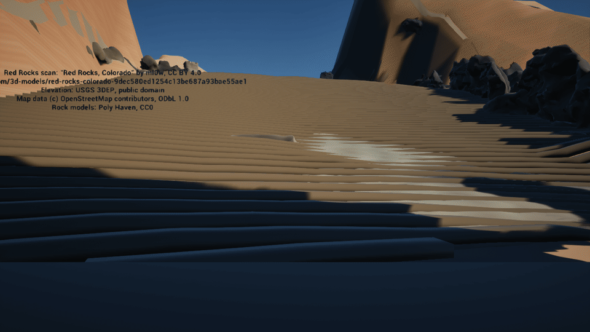
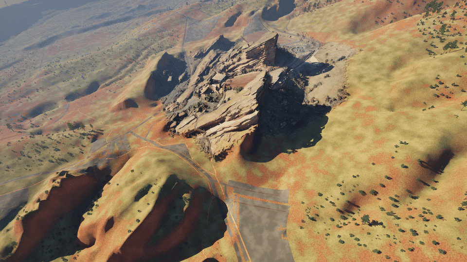

# red-dead-rocks

Builds a real-world **Red Rocks Amphitheatre** for Unreal Engine from public
geodata: a 1:1 terrain from the USGS DEM, the two flanking monoliths extruded
from their surveyed OSM footprints, and the OSM feature set for the park, all
georeferenced to a single origin.

This is the data half of the "GTA in your own city" idea. The Python package
writes engine-agnostic OBJ and heightmap files; the `unreal/` scripts import
them into a UE 5.8 project and build the level.

The local checkout lives at `~/dev/redrocks-ue`.

## Status

Working: DEM fetch, heightmap and terrain-mesh export, OSM ingest,
georeferencing, seating-bowl generation, monolith meshes, tests.

**In Unreal:** the project is at `~/Documents/Unreal Projects/RedRocks`
(UE 5.8, Apple Silicon). Its level `/Game/RedRocks/Lvl_RedRocks` holds the
terrain mesh, Creation Rock and Ship Rock at their real positions, a golden-hour sun, sky
atmosphere, sky light, height fog, a PlayerStart and a framing camera. It is the
editor startup map and the game default map.

The Unreal project is versioned separately in
[red-dead-rocks-unreal](https://github.com/austin80808/red-dead-rocks-unreal)
(private, assets in Git LFS). After a rebuild that you want to keep, commit
there:

```bash
cd "$HOME/Documents/Unreal Projects/RedRocks"
git add -A && git commit -m "Rebuild: <what changed>" && git push
```

To roll the level back, `git checkout <commit> -- Content/` with the editor
closed.

The sandstone material is applied to the terrain and both rocks. Written but not
yet run in the level: the bench import and the ml0w scan import (see the script
table). Stage blockout generated (not yet imported). The scan's placement is fitted by `tools/fit_scan.py` (scale within 8 % of 0.516 m/unit, then terrain heights plus stage and rock landmarks); see issue #14 for the residuals.

**Look (#18):** physically lit with Lumen GI and reflections, a 120 klx
late-afternoon sun low in the WNW through the SkyAtmosphere, a real-time sky
light, volumetric clouds, height fog and histogram auto exposure clamped to
EV100 11-14.2. The ground is procedural Fountain Formation sandstone: red soil
and olive grass on gentle slopes, banded red rock on steep ones, bands that fade
to their average colour with distance instead of shimmering. Benches are
weathered redwood planks on dusty concrete risers; the stage is concrete; roads,
lots and paths are asphalt and gravel with dusty edges. A generated terrain skirt
carries the hills out to the horizon (no more flat blue plane past the 2.4 km
terrain), and about 5,000 juniper-sized scrub clumps dot the open hillsides.
`configure_level.py` writes the render settings this needs into the project's
`Config/DefaultEngine.ini` (restart the editor after the first rebuild).

## What it produces

```
out/
  redrocks_heightmap.png   2017x2017 16-bit heightmap, Unreal landscape format
  RedRocks_Terrain.obj     377x377 grid terrain mesh, 282,752 triangles, cm
  Creation_Rock.obj        north monolith, 91.4 m, watertight
  Ship_Rock.obj            south monolith, 61.0 m, watertight
  Benches.obj              70 curved bench rows, 16,808 triangles, terrain frame
  Stage.obj                stage blockout, 13 parts, 148 triangles, terrain frame
  Roads.obj, Paths.obj     OSM highways as draped ribbons (21,118 / 23,000 triangles)
  Parking.obj              24 OSM parking lots as terrain-following patches (22,788 triangles)
  manifest.json            Z scale, bbox, origin, venue, monoliths, attribution
```

Clone with Git LFS installed: the scan, rock models and textures in `assets/`
are LFS files, and without it you get 133-byte pointer files instead.

```bash
git lfs install   # once per machine
git clone https://github.com/austin80808/red-dead-rocks.git
```

Run:

```bash
python3 -m venv .venv && .venv/bin/pip install -e .
.venv/bin/redrocks build --out out
```

`redrocks build` writes everything above. `--terrain-grid` sets the terrain
mesh resolution (default 377; `0` skips it).

Benches are one solid per generated row, 0.9 m deep and 0.45 m tall, in the
terrain mesh's frame so they need no transform in Unreal. Rows are arcs
centred on the stage (see below), so each bench bows around the bowl, and each
follows the ground: it is subdivided every 2.5 m and its seat top sits 0.45 m
above the terrain mesh at every station, with its base dropped to the lowest
ground under the section so no edge floats.

Current output for a 2.4 km box centred on the amphitheatre:

| | |
|---|---|
| Heightmap | 2017 × 2017, 16-bit |
| Ground resolution | 1.19 m per pixel |
| Elevation range | 1753.9 m – 2400.0 m (646 m relief) |
| **Z scale** | **126.2013** |
| Terrain mesh | 377 × 377 vertices, 282,752 triangles |
| OSM features | 15,114 nodes, 1,397 ways |

### Terrain mesh

The terrain goes into Unreal as a static mesh, not a Landscape. Landscape
heightmap import can't be driven from Python in vanilla UE, while an OBJ imports
through `AssetImportTask` like any other asset, including from a headless
commandlet. The cost is losing Landscape features (paint layers, grass,
Landscape LOD); the mesh can be swapped for a Landscape later.

Axes are X east, Y north, Z up, in centimetres, centred on the origin, with the
lowest point at Z = 0. Faces wind counter-clockwise seen from above, so normals
point up.

### Roads, paths and parking

`park.py` turns the OSM `highway=*` and `amenity=parking` ways into three more
OBJs in the terrain's frame (cm, X east, Y north, Z up, Z=0 at the terrain
minimum): `Roads.obj`, `Paths.obj` and `Parking.obj`. A file is skipped when the
data has nothing for it, and each present one is recorded under `park` in
`manifest.json`.

Ribbons are swept along each way, sampled every 2 m and draped on the *same
triangles* as `RedRocks_Terrain.obj` (cell-diagonal aware, so no float over or
sink into the mesh), then lifted by 3 cm (parking), 5 cm (roads) or 7 cm
(paths) so layers don't z-fight. Widths by `highway=*`, in metres:

| Class | Width |
|---|---|
| motorway, trunk | 10 |
| primary | 8 |
| secondary | 7 |
| tertiary, unclassified, residential | 6 |
| living_street | 4.5 |
| service (parking aisle 3) | 4 |
| track | 3.5 |
| cycleway | 2.5 |
| footway, pedestrian, bridleway | 2 |
| path, steps | 1.5 |

`*_link` uses its parent class, and a numeric `width=` tag overrides the table.
Roads are motorway down to track; cycleway and below are paths.
`tunnel=*` ways and closed `area=yes` ways are skipped; other `highway` values
(construction, proposed ...) are ignored. Bridges are draped, with no deck.
Every face has UVs: on ribbons U is distance along the way divided by its width
(square texels) and V runs 0 to 1 across; on parking, planar metres / 10.

### Monoliths

Both flanking rocks are extruded from their **surveyed OSM footprints**, so the
plan-view silhouette is real rather than invented. Heights come from the
official figures, not the DEM — the DEM reads 20–40 ft high because it samples
the ridge behind each rock.

| | footprint | height | top elevation |
|---|---|---|---|
| Creation Rock (north) | 163.6 × 94.8 m, 8,132 m² | 91.4 m (300 ft) | 2023.8 m |
| Ship Rock (south) | 236.1 × 177.2 m, 18,647 m² | 61.0 m (200 ft) | 1993.4 m |

Meshes are watertight, outward-facing, and their volume matches
footprint × height to six digits. Units are centimetres, matching Unreal. Side
walls carry UVs with perimeter distance along U and height along V, so strata
banding in a material runs horizontally.

The 30° westward strata dip is **not** applied as a geometric shear. The
monoliths are vertical columns; the dip is a property of the bedding and belongs
in the material as diagonal banding. Shearing the mesh would fake a lean that
does not exist.

### Stage blockout

`Stage.obj` is a blockout, not a model: boxes and wedges (vertical prisms with a
convex plan) for the stage deck, roof slab, four columns, the shell (back wall and
two splayed wings), the retaining wall behind the stage with a triangular return
at each end, and the walkway along the top of the bowl. It is one watertight
`Stage` object in the terrain's frame (cm, X east, Y north, Z up, terrain
minimum at Z = 0), counter-clockwise outward, with a UV on every face, so it
needs no transform in Unreal. `manifest.json` records the triangle range of each
part and every dimension with its source.

It is positioned from the data, not by hand. The stage axis runs from row 1's
centre to the last row's centre. The deck top is row 1's DEM elevation minus the
stage drop, its front edge sits 3 m downhill of row 1, and it extends away from
the audience. The walkway runs along the last row's chord at that row's
elevation. On the real build the deck top lands within about 1 m of the terrain
there.

**Sizes come from the ml0w scan where it could be measured.** `kind` in
`redrocks.stage.DIMENSIONS` is `published`, `derived`, `measured` (read off the
scan by `tools/measure_stage_scan.py`) or `estimate` (neither). The scan has no
units, so the script finds its own scale first from published figures: about
**0.516 m per scan unit** (bench rise 0.496, roof underside against the 12.24 m
SkyDeck grid 0.513, Creation/Ship Rock top difference 0.541, so roughly +-4%).
The fit used to place the scan in Unreal (`FIT_SCALE` in `unreal/import_scan.py`,
0.312 m per unit) is about 40% too small and puts the stage about 375 m from the
bowl; see issue #14. Measured values are right only to the confidence in their
source text: the roof is partly reconstructed and the scan cannot tell the
retaining wall from the rock it stands against.

| Dimension | Value | Kind | Confidence / source |
|---|---|---|---|
| Stage width | 26.3 m (was 24.4 estimate) | measured | roof plan width, medium-low (+-1.5 m); flat deck seen is at least 20.9 m |
| Stage depth | 27.9 m (was 21.3 estimate) | measured | deck front lip to the wall behind, medium (+-1.5 m) |
| Roof depth | 21.9 m, starting at the deck front | measured | medium (+-1.5 m); deck runs about 6 m further back |
| Roof slab sits at | 12.24 m (40'2") above deck | published | [IA Stage](https://www.iastage.com/red-rocks-amphitheater/); the scan's roof underside is 12.33 m |
| Roof thickness | 2.1 m (was 1.5 estimate) | measured | scan roof top 14.46 m minus the 12.33 m underside, medium-low (+-0.7 m) |
| Truss 1 / truss 3 behind downstage edge | 3.66 m / 18.90 m | published / derived | 12 ft, then 25 ft apart, [IA Stage](https://www.iastage.com/red-rocks-amphitheater/) |
| Columns | 4 | published | reduced from twelve, [Structure magazine](https://www.structuremag.org/article/new-stage-roof-rocks-iconic-venue/) |
| Deck top | row 1 elevation minus 0.2 m (was 1.2 m estimate) | derived + measured | deck level with the row-1 tread within 0.4 m, low confidence |
| Retaining wall gap / height | 2.1 m / 12.9 m (were 2.0 / 6.0 estimates) | measured | low (+-1 m / +-2 m): the height is the whole rear face, rock included |
| Front setback, columns size, shell, walkway width | see `stage.py` | estimate | not resolvable in the scan |

Re-run the measurement (needs `usd-core` in a venv, not a project dependency):
`.venv/bin/python tools/measure_stage_scan.py --cache $SCRATCH/scan.npz --out $SCRATCH/diag`.
It also writes a top-down height map and an axis cross-section with the
blockout outlines drawn over the scan.

## Scan edge blend

The ml0w scan and the 3DEP terrain differ by a median of about 4 m, and by
15 m or more around the rock fins, so the terrain used to bury a third of the
scan and the scan's ragged edge floated as shelves. Two halves fix it (#17):

* **Terrain** (`redrocks.scan_blend`, run by `redrocks build`): inside the
  scan's footprint the terrain mesh's vertices take the scan's own floor, 0.4 m
  lower, then drop wherever a triangle would still rise into the scan, so the
  scan always draws on top and the walkable ground follows it. Over 60 m outside
  the footprint a smooth (harmonic) fill takes the ground back to the DEM. Roads,
  paths and parking drape on the blended ground; the benches and stage keep the
  DEM under them (1 m keep-out, 6 m taper), as do the monoliths and the heightmap.
* **Scan material** (`unreal/import_scan.py`): `M_Scan_ml0w` is masked. A plan-view
  fade mask (0 at the footprint edge, 1 from 30 m in) broken up by world noise
  thins the scan into patches toward its edge, DitherTemporalAA softens them,
  and the last of it is tinted to the ground colour read from
  `MI_Sandstone_Ground`. Near-black texels in the scan's albedo are lifted toward
  shaded sandstone.

`tools/scan_heights.py` writes the inputs for both, `assets/scan/scan_heights.npz`
(scan floor, 2 m cells) and `assets/scan/scan_fade.png` + `.json` (the mask and
where it sits). Re-run it whenever the `FIT_*` constants in `import_scan.py`
change, then `redrocks build` and `rebuild_level.py`.

| Before | After |
|---|---|
|  |  |
|  |  |
|  |  |
|  |  |

## Play it



*Captured by `unreal/playtest.py` in the real project: the player spawns on the stage, walks 53 m and climbs 13 m up the bowl, then looks east, north, west and south.*



*From above: the generated terrain, rocks, benches, roads and parking with the ml0w scan placed over the bowl, then the scan on its own. Regenerate both with `tools/make_play_gifs.sh` after a play-test.*

Open the project, make sure `Lvl_RedRocks` is the open level, and press **Play** (green ▶).
You spawn on the stage deck facing up the bowl, with the credits beside you.
WASD to walk, mouse to look, Space to jump (you have to jump each bench row; there are no aisle stairs yet).
Press **C** to open or close the credits screen (a "C Credits" hint sits in the bottom-left corner).


The credits overlay is generated by `unreal/setup_credits.py`; its text comes from
`assets/*/ATTRIBUTION.md` and `out/manifest.json`'s `attribution` list, so it can't drift
from the sources. To check it without the keyboard:

```bash
"/Users/Shared/Epic Games/UE_5.8/Engine/Binaries/Mac/UnrealEditor.app/Contents/MacOS/UnrealEditor" \
  "$HOME/Documents/Unreal Projects/RedRocks/RedRocks.uproject" -nosplash \
  -ExecCmds="py /Users/austin/dev/redrocks-ue/unreal/playtest_credits.py"
```

It presses C through Enhanced Input (`Input.+key C`), writes `/tmp/redrocks_playtest_credits.log`
and saves `redrocks_credits_{hint,open,closed}*.png` under `Saved/Screenshots/MacEditor/`.

To check it without touching the keyboard:

```bash
"/Users/Shared/Epic Games/UE_5.8/Engine/Binaries/Mac/UnrealEditor.app/Contents/MacOS/UnrealEditor" \
  "$HOME/Documents/Unreal Projects/RedRocks/RedRocks.uproject" \
  -ExecCmds="py /Users/austin/dev/redrocks-ue/unreal/playtest.py"
```

It writes `/tmp/redrocks_playtest.log` and two screenshots under `Saved/Screenshots/`.

## Importing into Unreal

The scripts in `unreal/` run headless against the project:

```bash
UE="/Users/Shared/Epic Games/UE_5.8/Engine/Binaries/Mac/UnrealEditor-Cmd"
PROJ="$HOME/Documents/Unreal Projects/RedRocks/RedRocks.uproject"
"$UE" "$PROJ" -run=pythonscript -script=unreal/import_redrocks.py -unattended -nosplash -stdout
```

**To rebuild the whole level, run one script.** `rebuild_level.py` runs the
nine steps below in order (`import_redrocks.py` through `setup_credits.py`), clears
each step's old log first, stops at the first `ERROR`/`ABORT`/`FAIL` line in its
`/tmp/redrocks_*.log` (or a missing log), and prints a summary of step, status,
duration and log path (also saved to `/tmp/redrocks_rebuild.log`):

```bash
"$UE" "$PROJ" -run=pythonscript -script="$PWD/unreal/rebuild_level.py" -unattended -nosplash -stdout
```

or, in an open editor, `py "/Users/austin/dev/redrocks-ue/unreal/rebuild_level.py"`.
It **wipes every actor in the level** (step 1). The scripts can still run one at
a time, in this order; each writes a log to `/tmp/redrocks_*.log`:

| Script | Does |
|---|---|
| `rebuild_level.py` | **entry point:** runs the eight scripts below in order, stops at the first failure |
| `import_redrocks.py` | imports the terrain, rocks and benches OBJs to `/Game/RedRocks` and places them in `Lvl_RedRocks`. **Clears every actor in the level first.** |
| `setup_lighting.py` | golden-hour sun (120 klx, WNW, 24° up), sky atmosphere, real-time sky light, height fog, volumetric clouds, PlayerStart. Replaces the rig on every run |
| `configure_level.py` | writes Lumen / distance fields / VSM / eye adaptation / TSR into `Config/DefaultEngine.ini` `[SystemSettings]`; post-process volume with Lumen, auto exposure (EV100 11-14.2) and a light grade; framing camera |
| `fix_camera.py` | lifts the camera above the 645 m ridge, removes test actors |
| `setup_materials.py` | procedural materials: `M_Sandstone` (30° strata that fade with distance, soil, grass, slope rock) with rock and ground instances; `M_Benches` (redwood planks, concrete risers); `M_Concrete`, `M_Asphalt`, `M_Lot`, `M_Gravel`, `M_Scrub` |
| `setup_environment.py` | terrain skirt from the DEM edge out to 120 km so the world has a horizon; ~5,000 scrub clumps as one instanced mesh, off rock, roads and the scan |
| `import_scan.py` | imports the ml0w scan with Nanite and credits it; its material fades the scan out at its edge (see Scan edge blend); run after `import_redrocks.py` |
| `setup_gameplay.py` | imports Stage, Roads, Paths, Parking; complex collision on every walkable mesh; PlayerStart on the stage deck facing up the bowl; FirstPerson game mode; in-world credits. Runs last |
| `setup_credits.py` | the press-**C** credits screen: input action `IA_Credits` (C, in `IMC_Default`), Widget Blueprint `WBP_Credits`, Actor Blueprint `BP_CreditsMenu` placed in the level. Text from `assets/*/ATTRIBUTION.md` and the manifest. Runs after `setup_gameplay.py` |
| `verify_walkable.py` | headless checks: game mode, one PlayerStart, triangle counts kept, credits present; renders the spawn and bowl views |
| `playtest.py` | **the real test:** launches Play In Editor, lets the player land, walks and jumps up the bowl for 12 s, screenshots, quits. Needs the editor GUI (`-ExecCmds="py …"`) |
| `playtest_credits.py` | Play In Editor, checks the hint, presses C (open), C (close), screenshots each (`Shot showui`), quits. Needs the editor GUI |
| `render_preview.py` | renders the level to `Saved/redrocks_preview.png` |
| `diagnose.py` | lists actors, mesh triangle counts and the startup map |

Close the editor before running them, or the commandlet and the editor will
both hold `Lvl_RedRocks`. Inside a running editor, run one from the console
instead: `py "/Users/austin/dev/redrocks-ue/unreal/diagnose.py"`.

The `probe_*.py` scripts are the experiments that found the import problems
below; they are kept for reference.

### Landscape instead of a mesh

To use the heightmap as a Landscape:

1. New level, enable the **Landscape** plugin.
2. Landscape mode → **Import from File** → `out/redrocks_heightmap.png`.
3. Set **Scale X/Y** to `118.99` (cm per pixel, from the manifest) and
   **Z Scale** to `126.2013`.
4. The terrain is now 1:1 with reality. Place the player at the origin from
   `manifest.json` and the amphitheatre is where it should be.

The Z scale formula is `relief / 512 * 100`, because Unreal's landscape maps the
full 0–65535 heightmap range onto 100 units per 512 units of scale.

### Unreal gotchas

Each of these cost real time:

- **`unreal.Rotator` positional order is (roll, pitch, yaw).** Always pass
  keywords: `unreal.Rotator(pitch=-38, yaw=145, roll=0)`. Positional
  `(-38, 145, 0)` gives pitch 145°, which puts the sun below the horizon:
  the level renders as night, with black terrain and black sky.
- **OBJs need a UV channel.** Without `vt` lines, the OBJ importer fails an
  ensure and keeps only a fraction of the triangles (a 282,752-triangle terrain
  came back with 3,716). Every exported OBJ now carries UVs.
- **The OBJ importer mirrors north and south.** Interchange negates Y, so an
  OBJ vertex at north = +12071 cm lands at y = -12071. Every OBJ actor gets a
  Y scale of -1 (`import_redrocks.py`, `setup_gameplay.py`); without it the
  terrain, benches and stage are flipped against the rocks and the PlayerStart,
  and the player spawns on the benches instead of the stage.
- **`EditorAssetLibrary` does nothing while Play is running.** `load_asset` and
  `load_blueprint_class` return None during Play In Editor; use `unreal.load_asset`
  / `unreal.load_object` in play-test scripts.
- **UE 5.8 Python can author Blueprints and widgets headless.**
  `unreal.BlueprintGraphEditor` adds nodes and wires pins,
  `EditorUtilityLibrary.add_source_widget` builds a widget tree. Gotchas:
  `create_node_from_name` wants the menu path with spaces removed
  (`"UserInterface|CreateWidget"`, `"Input|EnhancedActionEvents|IA_Credits"`);
  a math node like Subtract is a wildcard until a pin is wired, so wire one
  input before setting the other's literal; most widgets (TextBlock, Border,
  panels) aren't Blueprint variables, but a WidgetSwitcher is.
- **`HighResShot` leaves out the UI.** To capture a UMG overlay use
  `Shot showui filename=<name>` (it appends a `00000` suffix).
- **`-ExecutePythonScript` quits the editor when the script returns.** For
  anything that has to run over several frames (Play In Editor), launch with
  `-ExecCmds="py <script>"` instead.
- **A PlayerStart buried in geometry is ignored.** Unreal drops a start whose
  capsule overlaps blocking geometry and spawns the pawn at the origin, under
  the terrain. The spawn height comes from manifest.json's `spawn` block.
- **`spawn_actor_from_object` does nothing in a headless commandlet.** Spawn a
  `StaticMeshActor` with `spawn_actor_from_class` and set its mesh instead.
- **The project config can switch Lumen off behind the level's back.** A
  `[SystemSettings]` block in `Config/DefaultEngine.ini` (Lumen, distance
  fields, VSM and eye adaptation all `0`) overrides every post-process volume;
  that is why the old level needed a 6 lux sun with a +12 exposure bias.
  `configure_level.py` now owns those lines. They load at start-up only.
- **The Noise material node's input is called `World Position`**, not
  `Position`, when wiring it from Python; ask
  `MaterialEditingLibrary.get_material_expression_input_names` when a
  connect returns False.
- **`/tmp/redrocks_*.log` is shared** by every project copy on the machine. Two
  rebuilds at once overwrite each other's logs; run one at a time.
- **A minimized editor looks frozen.** macOS throttles it to a few frames per
  second and it ignores input until it's brought forward and finishes compiling
  shaders.
- **The project still contains the FirstPerson template level**
  (`/Game/FirstPerson/Lvl_FirstPerson`: a grey platform with yellow pads). It
  isn't Red Rocks; open `Lvl_RedRocks`.

## Assets

| Folder | What | Licence |
|---|---|---|
| `assets/rocks` | 5 Poly Haven rock and cliff FBX models, for surface detail and scatter | CC0 |
| `assets/scan` | ml0w's drone photogrammetry of Red Rocks, 2,995,743 triangles, Y-up USD | **CC BY 4.0, attribution required** |

Each folder has an `ATTRIBUTION.md`. The scan's credit to ml0w has to appear in
any build that ships.

## Data sources

- **Elevation** — USGS 3DEP bare-earth DEM, public domain, via the
  `3DEPElevation` ImageServer. 1 m source resolution in this area.
- **Features** — OpenStreetMap via the main OSM API (not Overpass, which was
  rate-limited to the point of being unusable). ODbL 1.0, attribution required.

Both are fetched live; nothing is vendored.

## What the data actually gives you

**The bowl is real.** The DEM resolves 32.2 m of relief across the amphitheatre
footprint against an official stage-to-top-row rise of 30.48 m — a 6% error. The
surrounding hogback, the park road up from Morrison, and the rock formations all
come through correctly. The hillshade is instantly recognisable as Red Rocks.

**The seating rows are not in the DEM.** One row rises 0.44 m; a DEM pixel spans
1.19 m. Individual rows are 2.7× below the sampling floor, so terrain data can
never give you benches. They are generated instead, by cutting the OSM
`amenity=theatre` footprint into 70 concentric arcs about the stage and
distributing the official 9,525 seats across them in proportion to row length.

That is the honest boundary of free geodata: it gives you the *setting* exactly,
and the *venue* only as a footprint to build from.

### Verified against official figures

| | generated | official | error |
|---|---|---|---|
| Seats | 9,525 | 9,525 | 0 |
| Rise, stage → top row | 30.13 m | 30.48 m | −0.35 m |
| Rows | 70 | 70 | 0 |
| Seat pitch | 0.422 m (16.6 in) | 2.5 mi / 9,525 seats | — |

**Why arcs, and why about that point.** Real rows are arcs about the stage, and
a bench built from them can be level along its length. The other option, tracing
the DEM contour at each row's elevation, was rejected: one row is 0.44 m and the
DEM is 1.19 m per pixel, so contours that close together are alias noise, not
rows. Arcs need only the footprint and which end is the stage. The stage end is
the lower end of the footprint's long axis, and the arc centre sits 30 m
beyond it (the stage platform is in front of the first row). 30 m is where the
rows best match the terrain: the mean spread of ground elevation along a row
is lowest and flat from 20 m to 60 m out, and row elevations rise
monotonically from stage to top at 30 m and 40 m but not at 20 m or 60 m. Arc radii are spread from the
nearest to the farthest point of the footprint that still gives a row at least
5 m long, so all 70 rows exist (the straight slicer produced 68; its two
missing rows were slivers at the stage end).

Seat pitch is the strongest independent check: 2.5 miles of bench across 9,525
seats gives 16.6 inches per seat, which matches Red Rocks' famously
shoulder-to-shoulder benches. That figure was never an input — it falls out of
the official capacity and bench length.

## Storage

Disk was the original blocker; UE 5.8 is now installed under
`/Users/Shared/Epic Games/UE_5.8`, with about 46 GB free on the system disk
(2026-11-03).

Two files in the repo are over GitHub's 50 MB recommendation:
`assets/scan/usdz_extract/scene.usdc` (70 MB) and
`assets/rocks/sand_rocks_small_01.fbx` (57 MB). Both are under the 100 MB hard
limit; move them to Git LFS before adding anything larger.

### MEGA as storage

MEGA is a viable target for the *assets*, not the *working tree*.

- 3.3 TB quota, 2.2 TB free on the account already configured here.
- `mega-put` / `mega-get` / `mega-sync` are installed and authenticated.
- **No macFUSE**, so `mega-mount` is not available — there is no mounted volume
  to run the editor from. MEGA has to be sync-and-copy, not a live working disk.

That is the right shape anyway: closing a project on a network mount is slow
enough that Unreal's own docs advise against it. Keep the project and DerivedData
Cache on local disk, sync the source and built packages to MEGA.

## Next steps

1. Run `import_redrocks.py` (benches) and `import_scan.py` in the level, then
   tune the scan's placement constants by eye and decide whether it replaces the
   extruded monoliths visually, with the monoliths kept as collision.
2. Real trees and boulders (Poly Haven ponderosa/juniper, `assets/rocks`) in
   place of the sphere-clump scrub.
3. Import `Stage.obj` (see Stage blockout), then replace the blockout with detail.
   The stage and shell are not in any free dataset.
4. First-person traversal pass, then multiplayer.

For a *fantasy replication* rather than a survey-accurate twin, the monoliths,
tunnel, and stage shell are the pieces that carry the feel. Those are modelling
work, and no amount of geodata substitutes for them.

## Tests

```bash
.venv/bin/python -m pytest tests -q
```

Covers the projection (round-trip, axis orientation, distance accuracy), DEM
sampling and interpolation, the Unreal Z scale formula, heightmap encoding, OSM
parsing and feature classification, the seating bowl (arc rows, stage centre), curved and ground-following benches
(mitres, watertightness, terrain-mesh match), monolith geometry, roads/paths/parking, the OBJ
exports (terrain grid, benches, stage blockout, winding, and a valid UV on every face), and the
CLI build. No network in tests.

The `unreal/` scripts are only checked offline: they must parse, and none may
pass `unreal.Rotator` angles positionally. `rebuild_level.py`'s step order and
log parsing are unit-tested too (`tests/test_rebuild_level.py`). Running the
scripts needs the editor.
